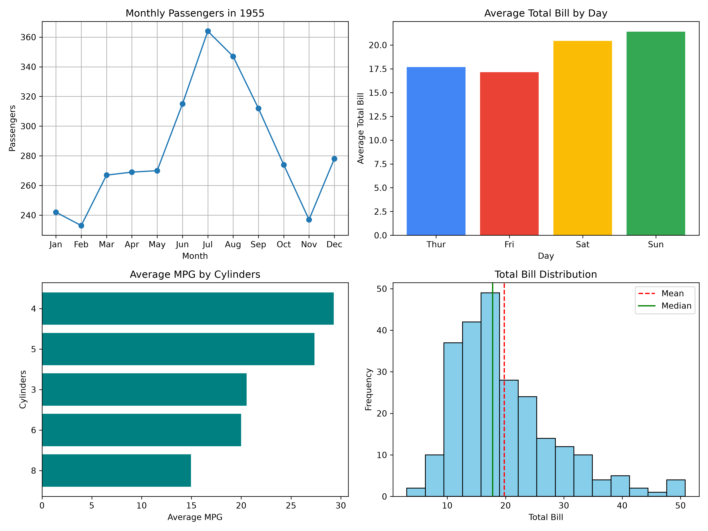

# Data Visualization Tasks: Matplotlib & Seaborn

GDG On Campus AI/ML Team, COMSATS University Islamabad (Attock Campus) — Month 2 weekly task.



## Files

| File | Description |
|------|-------------|
| `Matplotlib_tasks.ipynb` | 7 Matplotlib tasks |
| `seaborn_tasks.ipynb` | 7 Seaborn tasks |
| `dashboard.png` | Exported 2×2 mini dashboard (Matplotlib Task 7) |

## Matplotlib Tasks

Datasets: `tips`, `flights`, `mpg`

| # | Task | Data | Plot |
|---|------|------|------|
| 1 | Line Plot | `flights` | Monthly passengers in 1955 |
| 2 | Bar Chart | `tips` | Average total bill by day |
| 3 | Horizontal Bar Chart | `mpg` | Average MPG by cylinders |
| 4 | Histogram | `tips` | Total bill with 5, 15, 30 bins; mean and median lines |
| 5 | Scatter Plot | `mpg` | Weight vs MPG, sized by horsepower, colored by origin |
| 6 | Donut Chart | `tips` | Smoker vs non-smoker share |
| 7 | Mini Dashboard | combined | 2×2 grid of Tasks 1–4, saved as `dashboard.png` (300 dpi) |

## Seaborn Tasks

Datasets: `penguins`, `titanic`, `tips`

| # | Task | Data | Plot |
|---|------|------|------|
| 1 | Countplot | `titanic` | Passengers by class and sex |
| 2 | Histogram with KDE | `penguins` | Flipper length by species |
| 3 | Box vs Violin | `penguins` | Body mass by species, side by side |
| 4 | Scatterplot | `penguins` | Bill length vs depth (hue: species, style: sex) |
| 5 | Heatmap | `penguins` | Correlation matrix of numeric features |
| 6 | Pairplot | `penguins` | Pairwise plots colored by species |
| 7 | lmplot | `tips` | Total bill vs tip, split by time and smoker |

## Setup

```bash
pip install seaborn matplotlib jupyter
jupyter notebook
```

- Datasets load via `sns.load_dataset()`, so an internet connection is needed on first run.
- Run notebooks top to bottom. Matplotlib Task 7 reuses variables from earlier cells.

## Author

**Abdul Wahid** — [GitHub](https://github.com/abduIwahid) · [LinkedIn](https://linkedin.com/in/abdu1wahid)
